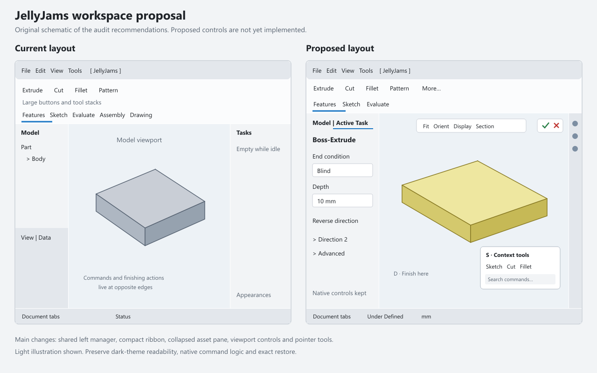

# JellyJams interface audit and improvement roadmap

Audit date: 2026-11-05. Reference application inspected: **SOLIDWORKS Design Professional 2026 SP4.0**. JellyJams baseline: the current working tree, FreeCAD **26.3 RC2**, with compatibility obligations for **1.1.4**.

The largest improvement would come from making common actions available where the user is already working: a context-sensitive **S shortcut bar**, **confirmation controls in the viewport**, and a **shared left-side model/task manager**. Correct document context and a less crowded workspace should accompany those changes. JellyJams already supplies much of the familiar vocabulary and several important gestures; additional renamed buttons alone would have less impact.

This is an audit and proposed implementation plan. The proposed UI below is a schematic, and the backlog is not an assertion that its features have been implemented.

Implementation follow-up (2026-11-05): the initial versions of **UX01, UX02 and
UX04** are now implemented in the working tree: S command search, D/task-corner
confirmation, and document/context tab memory. Their normative behavior and
limits are in [quick-access](../specs/quick-access.md) and [ribbon-engine
3.4](../specs/ribbon-engine.md#34-document-and-edit-context); current test results
are in [status](../status.md). The shared left manager, customizable icon grid
and other backlog proposals remain future work. The schematic is not a capture
of the implemented interface.

## Evidence and coverage

Three evidence levels are used throughout:

- **Observed:** exercised in the running application during this audit.
- **Code/spec:** established by repository code, specifications, or recorded test results; not a new manual comparison of both applications.
- **Proposal:** an improvement whose implementation and acceptance checks remain to be completed.

In SolidWorks, a separate unsaved reference part, `Part2`, was created. The walkthrough covered feature-first plane selection, sketch entry, origin snapping, rectangle creation, closed-contour feedback, the part and sketch S bars, extrusion preview, the left PropertyManager and D confirmation controls. The existing user models were not used for geometry edits. The original document was restored as active; `Part2` remains open and unsaved as a reference. Assembly and drawing comparisons below use their specifications and official documentation, rather than a new complete hands-on SolidWorks assembly/drawing test.

JellyJams was inspected in an isolated FreeCAD process using `scratch/ux_audit_live/user.cfg` and `system.cfg`. A simple rectangular pad and its sketch were used for the layout, feature-edit and sketch-edit checks. The five-tab capture suite completed successfully under `scratch/gui_0emxjmr1`; all five tabs were captured, with no recorded errors. Its result is a capture completion check, not a numerical usability score.

The preceding change's **619/619 headless tests on each supported host**, **35/35 plane-choice checks on each**, and existing lifecycle results were the audit-time functional baseline. They do not establish perceptual similarity. The subsequent implementation and its newer results are recorded in [status.md](../status.md).

Official research includes current 2027 material and the [2027 What's New PDF][sw-new-pdf]. **That PDF identifies itself as PRERELEASE.** Its interface chapter, printed pages 16–20, covers recent-document presentation, tree-width policy, component status, remembered dialog sizing and overflow tab navigation. The installed 2026 SP4.0 application remains the observed behavior reference. Some web-help topic opens returned only the site's navigation shell; indexed official topic text and the readable PDF supplied the relevant documentation. Versions are retained on individual citations.

Qt `grab()` captures of FreeCAD's OpenGL viewport showed capture artifacts. The live Windows capture rendered the model normally. The artifacts are not evidence of a JellyJams geometry or rendering defect.

## What already feels familiar

| Area | Current foundation | Evidence and remaining difference |
|---|---|---|
| CommandManager | Bottom tabs, large buttons, compact stacks, split flyouts and remembered variants | Code/spec and fresh captures. Five pages remain available globally; customization and compact modes are absent. |
| Sketch entry | Feature-first sketching, single-click plane confirmation, staying in JellyJams | Native acceptance results. This matches the documented [feature-first workflow][sw-sketch-first]. |
| Drawing aids | Native object snapping and automatic constraints enabled for the edited sketch | Recorded native tests. External model references and every inference case are separate concerns. |
| Dimension placement | Native Smart Dimension with the linear preview gap corrected | Recorded native tests. Full selection, type-switching and cancel parity has not been established. |
| View navigation | Native navigation preset, balanced orbit, Space Orientation, Ctrl+8 Normal To | Code/spec and prior native tests. Preserve this foundation. |
| Tree names | Familiar sketch, feature, plane, mate and drawing labels | Code/spec. Labels do not change FreeCAD's tree hierarchy or history semantics. |
| Task terminology | Familiar labels on many native controls | Observed in Pad edit. Native task headers and some solver wording remain visible. |
| Relations and mates | Context-sensitive Add Relations and Add Mate panels | Code/spec and earlier tests. Their host and native follow-up dialogs still differ from SolidWorks. |
| Appearances | Existing browser, presets, face/object colours and local component overrides | Code/spec. This is implemented; the old missing-feature list overstates this gap. |
| Measure | Temporary panel, geometry readouts, center/axis distance and viewport callouts | Code/spec. Copy/history, independent reference choices and custom coordinates remain gaps. |
| Drawings | Separate drawing creation, projected views, view dragging, scale, symbols and exports | Code/spec and prior native coverage. View-palette and annotation workflows remain incomplete. |
| Restore | Leave, quit, cancelled quit and crash recovery contracts | Extensive recorded tests. Every proposed interface change must retain these guarantees. |

## Findings that should drive the next changes

### 1. Put common commands at the pointer

**Observed:** SolidWorks S opens different tool collections in part and sketch mode, with command search in the popup. JellyJams' [shortcut table](../../jellyjams/shortcuts.py) provides orientation, rebuild and view shortcuts, but no S bar. Its current face-context popup offers one Sketch action.

The official [Shortcut Bars help][sw-shortcut] defines separate part, assembly, drawing and sketch collections. Add those four contexts using the existing ribbon command records, icons, active-state checks and `ribbon.run_entry` dispatch. Start with a curated collection, not every ribbon entry. Offer English command search and useful aliases such as Pad → Extruded Boss/Base and Pocket → Extruded Cut.

**Acceptance:** S works over the model during sketch edit; typing S into names, values, equations or search fields remains typing. Opening the bar does not clear selection. Escape dismisses the popup. Choosing a command preserves the same sketch-first, Measure and drawing dispatch behavior as the ribbon. Screen-edge placement, keyboard navigation and stale/deleted widgets are covered. Customization can follow after the defaults work reliably.

### 2. Add a confirmation corner and D popup with truthful actions

**Observed:** SolidWorks shows feature confirmation in the upper-right viewport. After focusing the graphics area, D moves accept/cancel buttons beside the pointer. JellyJams leaves feature OK/Cancel in the right task dock; Exit Sketch is on the ribbon. The official [Accepting Features help][sw-confirm] describes these routes.

Add a small owned overlay bound to the **current document's active native task**, plus a D popup. Reuse native buttons and their enabled state. During sketch edit, offer Exit Sketch through the native sketch command.

**Important semantic requirement:** Exit Sketch and Cancel Sketch are different operations. FreeCAD's sketch task does not automatically provide an equivalent discard action in every situation. Expose a destructive cancel only when its transaction semantics have been verified. A red X must never silently commit a sketch, discard unrelated changes, or confirm a different document's task. Keep native controls available.

**Acceptance:** feature acceptance/cancellation, disabled OK, an invalid preview, a dimension dialog, switching documents, opening another task, sketch-first cancellation and workbench leave all target the correct operation. D typed in a dimension or equation stays text. Overlay placement respects the navigation cube and undocked/split views.

### 3. Reclaim the idle right side and consolidate model/task management

**Observed:** SolidWorks' PropertyManager occupies the left manager area in place of the feature tree. Its right Task Pane is a separate library/services area. See [PropertyManager Overview][sw-manager]. JellyJams deliberately docks Tasks on the right, and the existing Appearances browser shares that area.

In the 1800-logical-pixel audit window, the idle Tasks area was **290 pixels wide** and Model was **260 pixels wide**. Those side areas together used about **31%** of the window width before separators. This was measured from Qt widgets; it is not a same-resolution benchmark against SolidWorks.

First hide or collapse the empty task area when no task or owned panel needs it, preserving explicit user choices. Then introduce a left manager arrangement that switches between Model and active Tasks. Keep Appearances available separately on the right through a collapsed tab/rail. Retain an advanced property editor, with an explicit way to reopen it.

The initial implementation should arrange native docks and add an owned switcher. Replacing FreeCAD's tree or reparenting its internal task widgets would add substantially more risk. This intentionally revises the current [window-layout spec](../specs/window-layout.md); it is a product change, not a defect in that spec's implementation.

**Acceptance:** no empty right dock on an idle part; tasks appear when needed; Model returns after task close; user-resized widths remain usable; all native fields remain reachable at small widths and 125–200% scaling. Exact leave/quit/crash behavior and a user closing a dock must remain correct.

### 4. Make document context reliable and timely

**Observed:** after the tab walkthrough, reopening JellyJams on the audit part retained **Drawing** as the selected tab, even while editing its Pad. Source inspection explains the behavior: [ribbon._update_context](../../jellyjams/ribbon.py) handles entry into drawing/assembly and sketch transitions, but does not maintain a complete per-document return policy.

Store the last deliberate tab per document/context, choose Features for a fresh part, and restore the relevant context when switching between parts, assemblies and sheets. Manual tab choices within the same context should stay put. Decide separately whether unrelated tabs are hidden or merely available; a global all-tabs option can preserve discoverability.

The ribbon refresh interval is **450 ms**, dialog-term scanning is **250 ms**, and the sketch watcher is **150 ms**. These constants establish possible update delays; this audit did not measure end-to-end latency. Coalesce document/edit/selection events into deferred updates and retain a slower fallback poll. Set a proposed acceptance target of a visible context update within **100 ms** in an otherwise idle GUI, then measure it.

### 5. Finish the sketch experience before adding more geometry tools

The recent snapping, dimension-preview and one-click plane fixes address real friction. The next work should cover the complete draw → dimension → edit → finish loop:

- Add a concise **Under Defined / Fully Defined / Conflicting** indicator and usable units display. In the native sketch audit, the task still displayed “Under constrained” and a degrees-of-freedom link. Keep detailed solver information available, while making the everyday state easy to find. SolidWorks distinguishes several [geometry states][sw-sketch-status], so colour alone should not carry every status.
- Preserve and test FreeCAD's existing **On-View-Parameters**. They already provide numeric input during creation; the installed 26.3 host reports the default visibility mode as 1. The [FreeCAD tutorial][fc-numeric] and installed `SketcherTests/TestOnViewParameterGui.py` document the native foundation. Compare its Tab/Enter/Escape behavior against [SolidWorks Numeric Sketch Input][sw-numeric]. A second numeric-input implementation would create competing focus and solver behavior.
- Verify two-point distance orientation, angular selection, radius/diameter switching, reference dimensions, editing an existing value and undoing one mistaken pick. The [2D dimensioning documentation][sw-dimension] makes selection and placement part of the tool's behavior. Matching the linear label position covers only one part of that contract.
- Make relation feedback and quick snap choices discoverable. Enabling snapping is not equivalent to automatic external projection or full model-edge associativity. The [Relations/Snaps options][sw-snaps] distinguish these behaviors.
- Prototype closed-contour shading as a **temporary visualization**. In SolidWorks, the rectangle shaded as soon as it closed; the [contour help][sw-contours] describes selectable closed regions. Handle nested loops, construction geometry and self-intersection correctly before offering region-driven extrusion. No document face objects should be generated merely to shade the sketch.
- Standardize Escape and repeated-tool behavior through tests. Cancel the in-progress step/tool before leaving sketch edit where appropriate; preserve numeric-entry Escape behavior. Native preferences and tool modes must be accounted for.

### 6. Make plane names and selection cues consistent

SolidWorks displayed Front, Top and Right plane labels in the feature-first picker. JellyJams renames tree labels, but 26.3's native plane renderer uses role labels **XY/XZ/YZ**. The user's screenshot and the native renderer agree on this remaining mismatch. [ViewProviderPlane::getLabelText][fc-plane-source] selects the role text directly.

A low-risk first step is an owned chooser/hint showing **Front (XZ), Top (XY), Right (YZ)**, with a normal-to thumbnail or highlight and exactly one-click confirmation. Retain explicit coordinate information for FreeCAD interoperability. Changing the native scene labels requires a capability probe and a precise cleanup strategy; changing the document's plane identity or global axes is unnecessary.

### 7. Audit command promises and task presentation

The existing [approximate-mapping inventory](../specs/ribbon-content.md#28-approximate-mappings-to-be-reviewed) deserves command-by-command acceptance examples. Display/Delete Relations currently selects constraints; Repair Sketch opens native validation; General Table is a spreadsheet view; horizontal chain/baseline dimensions are not a general orientation-independent workflow. Those are meaningful behavior gaps behind familiar labels.

Do not infer geometry from an internal command name. The 26.3 source explicitly identifies `Sketcher_CreateOblong` as **Rounded Rectangle**, creating the rounded rectangle handler. It should not be “fixed” into a slot merely because its internal identifier says Oblong. [Native command source][fc-create-source].

In the live Pad task, familiar Depth and End Condition labels coexisted with **Pad Parameters**, native preview groups and an expanded direction-vector editor. Introduce a consistent task title, compact common controls, and collapsed advanced options where supported. Native task-box captions are outside today's relabeling spec, so extending that scope requires a deliberate spec update. Keep expressions, units and native command logic intact.

Tooltips should lead with the familiar action and the required selection. Put implementation mappings and special limitations in secondary help. The current [ribbon tooltip composition](../../jellyjams/ribbon_text.py) often leads with both product names, which is more useful for debugging than for everyday modeling.

## Prioritized implementation backlog

P1 means the next daily-use release; P2 follows once the core workflow is stable; P3 is a separate parity project. S/M/L/XL are relative engineering scope, not delivery promises. Proposed work is not already verified.

| ID | Priority | Improvement and completion condition | Scope | Likely code boundary |
|---|---|---|---|---|
| UX01 | P1 | S bar with part/sketch/assembly/drawing defaults and command search; selection/focus preserved | M | New popup/rules module; `ribbon_model`, `ribbon.run_entry`, `shortcuts` |
| UX02 | P1 | Confirmation corner and D popup, bound to the active native task; correct sketch exit/cancel semantics | M | New overlay/task adapter; `fcgui`, `sketch_gesture`, `shortcuts` |
| UX03 | P1 | Collapse idle Tasks; left Model/Task manager; reopen advanced properties and right Appearances reliably | L | `layout`, `panel_host`, `fcgui`, lifecycle and restore tests |
| UX04 | P1 | Per-document tab/context return; fresh parts start on Features; manual choices survive | M | `ribbon`, pure context rules and document/edit observers |
| UX05 | P1 | Clear sketch state and unit controls; solver detail remains reachable | M | Owned status UI; native Sketcher status/units adapters |
| UX06 | P1 | Native numeric-input and Smart Dimension interaction acceptance suite, followed by targeted fixes | M | `sketch_assist`, `sketch_dimension`, native tool integration |
| UX07 | P1 | Consistent Front/Top/Right plane choice, with coordinate aliases and one-click entry | S/M | `sketch_gesture`, `naming_rules`, optional owned picker |
| UX08 | P1 | Truthful command mappings, common task titles and useful selection hints | M | `ribbon_layout`, `ribbon_text`, `dialog_terms_data`, area adapters |
| UX09 | P1 | Responsive ribbon sizing/overflow; optional compact mode; readable captions at mixed DPI | M | `ribbon_widgets`, `theme`, layout rules |
| UX10 | P1 | Small heads-up view strip: fit, area zoom, orientation, display style and section; behaves during tasks | M | Owned viewport overlay using verified existing commands |
| UX11 | P1 | Options page for context popup, layout, density, aids and visual preset; per-setting reset | M | New preferences module/UI; existing JellyJams preference group |
| UX12 | P1 | One coherent Undo per logical action where JellyJams adds follow-up edits | M/L | Section/detail labels, picture placement, sketch helpers, `doc_utils` |
| UX13 | P1 | Input/focus, cancellation and lifecycle regression matrix shared by every new popup/overlay | M | Test infrastructure and each area's native GUI suite |
| UX14 | P2 | Expand selection toolbars: Edit Sketch/Feature, Hide/Show, Appearance, Normal To and matching edge tools | M | Generalize `context_sketch` with pure offer rules |
| UX15 | P2 | Optional classic light presentation and matching dark presentation; readable preview/selection states | M | `palette`, `theme`, `viewport`; exact restoration for new overrides |
| UX16 | P2 | Temporary closed-contour shading and gap indication; nested/invalid profiles behave correctly | L | New sketch visualization adapter; native geometry/solver queries |
| UX17 | P2 | Selection filters, Select Other, selection breadcrumbs and component ownership hints | L | Native selection adapters/gates plus owned popup UI |
| UX18 | P2 | Searchable feature tree, expanded active body, visible edit/hidden/error status and compact property access | L | Native tree integration; start with reversible presentation only |
| UX19 | P2 | RMB gesture guide with context defaults; normal context menu and component rotation remain correct | L | Viewport input arbitration shared with `orbit` and assembly tools |
| UX20 | P2 | Continuous mate workflow with clear references, flip/alignment controls and remaining freedom feedback | L | `mate_rules`, `mate_panel`, native Assembly adapters |
| UX21 | P2 | Drawing view palette and placement preview, consistent sheet/view properties, dimension/annotation editing | L | Existing drawing helpers, native TechDraw task adapters |
| UX22 | P2 | Measure copy, units/reference choices; separate Mass Properties with explicit material/density semantics | M/L | `measure`, new pure measurement/material rules |
| UX23 | P2 | New Part/Assembly/Drawing entry flow, useful templates and consistent recent-document access | M | Existing new-assembly/make-drawing commands plus owned launcher |
| UX24 | P2 | CommandManager/S-bar customization with versioned user-owned layouts and reset | L | `ribbon_model`, `ribbon_layout`, preference schema |
| UX25 | P3 | Rollback history UI with correct feature/dependency behavior | XL | Body history and native document transactions; feasibility first |
| UX26 | P3 | Equations/global variables and configurations with suppression and dependency validation | XL | Expressions/variable sets/tables; separate document contract |
| UX27 | P3 | Advanced appearance hierarchy, textures/scenes/decals and saved display states | XL | `appearances`; capability research before a new material contract |
| UX28 | P3 | Instant3D-style handles, advanced fillets, surface, sheet-metal and weldment workflows | XL | Geometry/host capabilities and optional external workbenches |

### Recommended delivery order

1. **Establish reusable context and task adapters.** One source for active document/view, edit task, command eligibility and text-focus ownership. Use deferred/coalesced events, with conservative fallbacks. Add the input/cancel test matrix at this stage.
2. **Ship S bar and confirmation controls.** These bring daily commands and finishing actions close to the model, with modest impact on existing geometry behavior. Add the heads-up view strip using the same overlay infrastructure.
3. **Fix context return and task-space use.** Per-document tabs and idle dock collapse can ship before the full left manager redesign. Test document switches and user-chosen tabs explicitly.
4. **Finish the sketch loop.** Status, plane naming, native numeric entry, dimension selection, Escape, relation feedback and undo come before contour-driven features.
5. **Tune the shell.** Left manager, ribbon density/overflow, options and visual presets. Then generalize selection toolbars and improve assembly/drawing continuity.
6. **Take on deep parity projects separately.** History rollback, configurations and advanced geometry need independent feasibility and document-compatibility designs.

## Visual direction

The schematic proposes a compact top CommandManager, a shared left manager, an unobtrusive viewport view strip, a confirmation corner, and a collapsed right asset pane. Its light appearance illustrates an optional classic presentation. The same arrangement must support the current dark palette.

- **Density and typography:** use a common text baseline and configurable compact/comfortable sizing. Current ribbon icon sizes are 32/20 logical pixels and captions are forced to 8 pt. Respect font metrics and test 100%, 125%, 150% and 200% scaling; do not assume an exact pixel match from differently sized screenshots.
- **Ribbon overflow:** `_build_page` currently lays out every group in a horizontal box. Add a deliberate overflow/scroll policy and test narrow windows, long captions and flyouts. Bottom tabs and remembered split-button choices already provide a sound foundation.
- **Theme:** offer a familiar light workspace without changing FreeCAD's global Theme/StyleSheet setting. Preserve the accessible dark geometry colours; Fully Defined black on a dark background would reduce legibility. Current dark green is an intentional usability choice.
- **Preview and selection:** compare preview fill, outline width, hover feedback, selected geometry and relation markers together. The observed SolidWorks extrusion preview was translucent yellow, while the native FreeCAD preview was green. Changing this requires verified host hooks and exact restore, not a stylesheet assumption.
- **Task hierarchy:** feature title, accept/cancel, common options, selection boxes, then advanced controls. Keep the important fields visible in a short panel; make status/help consistent across native and JellyJams tasks.
- **Icons:** normalize sizes, alignment and hit areas. Under current repository rules, FreeCAD commands retain runtime FreeCAD icons and JellyJams commands use original artwork. Copying SolidWorks' icons is outside this plan.
- **Feedback:** prefer persistent local status and actionable next-pick hints over short-lived text alone. Use a clear active-tool indication, tool-specific cursor feedback where native APIs support it, and text alongside colour for errors and solve state.

## Assembly and drawing priorities

For assemblies, the high-value feel improvements are component selection clarity, a continuous Mate session, predictable flip/alignment behavior, visible fixed/floating/mated state and consistent move/rotate controls. The existing Add Mate panel, separate New Assembly, file drop and component rotation should be extended. Joint labels must be checked against degrees of freedom, since a familiar name alone does not establish identical solver behavior. Reference [SolidWorks mate behavior][sw-mates] and the current [assembly spec](../specs/assembly.md).

For drawings, keep the existing separate drawing document and projected-view helpers. Add a visual model/view palette, a placement preview, coherent annotation selection and editing, and view-specific property access. Improve dimension alignment, reference attachment and one-step undo before expanding the annotation catalogue. BOM/revision tables, Model Items and full automatic ballooning are larger capability gaps. Test both projection standards and units explicitly.

The 2027 interface chapter adds useful direction for later tree work: consistent width policy, visible modified/read-only component status, and tidy display controls. Its tab-overflow navigation also supports prioritizing a deliberate overflow policy. These are documented 2027 directions, not observations from the installed 2026 application. [2027 interface chapter][sw-new-pdf].

## Feasibility and boundaries

**Well suited to the existing Python workbench:** shortcut/search popup, task-bound confirmation, view strip, context return, status UI, preferences, native dock arrangement, selection toolbars and tooltip cleanup. Native-widget lifetime and event ordering still require real GUI tests.

**Require a prototype before a product promise:** contour shading, selection-through/breadcrumbs, RMB gestures, per-document tree presentation, appearance inheritance and live feature manipulators. Each crosses native input, rendering or document boundaries.

**Large document or geometry projects:** configurations, rollback, advanced surface/fillet parity, sheet metal and weldments. FreeCAD Body Tip controls insertion/history visibility concerns; setting it alone is not proof of SolidWorks rollback semantics. Similarly, reconstructed surface poles and reference radii do not become a native editable driving fillet merely through a new panel.

Preserve the project's exact-restore contract. New persistent overrides require backup-before-write, absent-key removal, startup recovery, leave/quit/cancelled-quit coverage and saved-config checks. Owned settings such as S-bar layout are user preferences, not overrides of FreeCAD settings; document them separately. New UI must use original owned widgets, scoped styling, standard-library/bundled dependencies and no application-wide event filter.

## Acceptance plan

Use the same neutral fixtures on both supported FreeCAD hosts. Every new interaction should cover no document, idle part, sketch, active feature task, assembly and drawing as applicable.

| Journey | Required checks |
|---|---|
| Fresh part → Extrude → plane → sketch → rectangle → dimensions → extrusion | One plane click; correct support; snapping/relations; numeric-entry focus; preview position; one feature; predictable finish/cancel |
| Sketch correction | Wrong pick → Escape; dimension type switch; reference dimension; double-click value edit; conflict feedback; undo/redo |
| Input at pointer | S, D, Space and Ctrl+8; name/value/expression/search inputs retain typing; popup/menu dismissal and focus restoration |
| Document/task switching | Part ↔ drawing ↔ assembly; two documents with tasks; active document closes; no action targets a stale task |
| Visual responsiveness | Narrow window; all supported scaling levels; mixed-DPI monitor move; keyboard navigation; light/dark; readable disabled/selected/error states |
| Assembly and drawing | Linked component references and sibling protection; mate cancellation; projection standard; annotation edits; export unaffected |
| Restore | Leave, quit, Save/Discard, cancelled quit, autoload, forced termination and startup recovery; original profiles untouched |

Count meaningful journeys and failures, not just screenshots or number of renamed tools. Measure time/clicks from command start to a valid finished feature, mistaken-action recovery, context-update latency and available model area. Establish a baseline before claiming an improvement percentage.

## Documentation corrections identified

The current missing-feature roadmap should distinguish the implemented Appearances browser from missing scenes/decals/display states. Its Body Tip suggestion also needs the rollback qualification above. Keep historical verification dates and results intact, and link this audit as the current planning inventory. No behavior specification is changed merely by listing a proposal here.

## Sources and implementation references

The principal official references are linked next to the claims they support. The report's proposed designs, priorities, effort sizes and acceptance targets are engineering recommendations.

- [SOLIDWORKS 2027 published enhancement overview][sw-new-web] and [2027 What's New PDF, marked PRERELEASE][sw-new-pdf].
- [Interface overview, 2027][sw-ui]; [CommandManager, 2026][sw-commandmanager]; [Shortcut Bars, 2026][sw-shortcut].
- [Accepting Features, 2025][sw-confirm]; [PropertyManager Overview, 2024][sw-manager]; [Heads-up View Toolbar, 2026][sw-headsup].
- [Feature-first sketch tutorial, 2027][sw-sketch-first]; [Numeric Sketch Input, 2026][sw-numeric]; [2D Dimensioning, 2026][sw-dimension].
- [Relations/Snaps options, 2024][sw-snaps]; [Shaded Sketch Contours, 2025][sw-contours]; [Sketch Geometry Status, 2026][sw-sketch-status].
- [Selection methods, 2022][sw-selection]; [Mouse gesture customization, 2027][sw-gestures]; [Rollback Bar, 2023][sw-rollback].
- Repository: [architecture](../architecture.md), [specifications index](../specs/README.md), [current verification status](../status.md), [ribbon widgets](../../jellyjams/ribbon_widgets.py), [layout](../../jellyjams/layout.py), [palette](../../jellyjams/palette.py), [panel host](../../jellyjams/panel_host.py).

[sw-new-web]: https://www.solidworks.com/product/whats-new/solidworks-design-2027
[sw-new-pdf]: https://files.solidworks.com/Supportfiles/Whats_new/2027/English/whatsnew.pdf
[sw-ui]: https://help.solidworks.com/2027/english/SolidWorks/sldworks/c_user_interface_overview.htm?id=2.0
[sw-commandmanager]: https://help.solidworks.com/2026/english/SolidWorks/sldworks/c_commandmanager.htm?id=2.12.4.2
[sw-shortcut]: https://help.solidworks.com/2026/english/SolidWorks/sldworks/c_shortcut_bars.htm?id=3.4.1.3
[sw-confirm]: https://help.solidworks.com/2025/English/SolidWorks/sldworks/c_accepting_features.htm?id=0182bb2a94f04b6bbab45573125fb0cb
[sw-manager]: https://help.solidworks.com/2024/English/solidworks/sldworks/r_pm_overview.htm
[sw-headsup]: https://help.solidworks.com/2026/English/SolidWorks/sldworks/c_heads_up_view_toolbar_commands.htm
[sw-sketch-first]: https://help.solidworks.com/2027/english/swtutorialonline/t_tut_lesson1_sketchingbase.htm
[sw-numeric]: https://help.solidworks.com/2026/english/SolidWorks/sldworks/t_numeric_sketch_input.htm?id=28.13.12
[sw-dimension]: https://help.solidworks.com/2026/english/SolidWorks/sldworks/t_Dimensioning_a_2D_Sketch.htm?id=28.19.1.0
[sw-snaps]: https://help.solidworks.com/2024/english/solidworks/sldworks/r_relations_snaps_options.htm
[sw-contours]: https://help.solidworks.com/2025/english/SolidWorks/Sldworks/c_Shaded_Sketch_Contour.htm
[sw-sketch-status]: https://help.solidworks.com/2026/english/SolidWorks/sldworks/c_Sketch_Geometry_Status.htm?id=28.19.1.20
[sw-selection]: https://help.solidworks.com/2022/english/solidworks/acadhelp/c_Selection_Methods.htm
[sw-gestures]: https://help.solidworks.com/2027/english/SolidWorks/sldworks/HIDD_CUSTOMIZE_MOUSE_GESTURES.htm?id=2.12.3
[sw-rollback]: https://help.solidworks.com/2023/English/SolidWorks/Sldworks/c_rollback_bar.htm
[sw-mates]: https://help.solidworks.com/2026/english/SolidWorks/sldworks/c_machine_desing_tools_overview.htm?id=3.2
[fc-numeric]: https://blog.freecad.org/2024/10/20/tutorial-on-view-parameters/
[fc-plane-source]: https://github.com/FreeCAD/FreeCAD/blob/9fb16e7f9/src/Gui/ViewProviderPlane.cpp
[fc-create-source]: https://github.com/FreeCAD/FreeCAD/blob/9fb16e7f9/src/Mod/Sketcher/Gui/CommandCreateGeo.cpp
